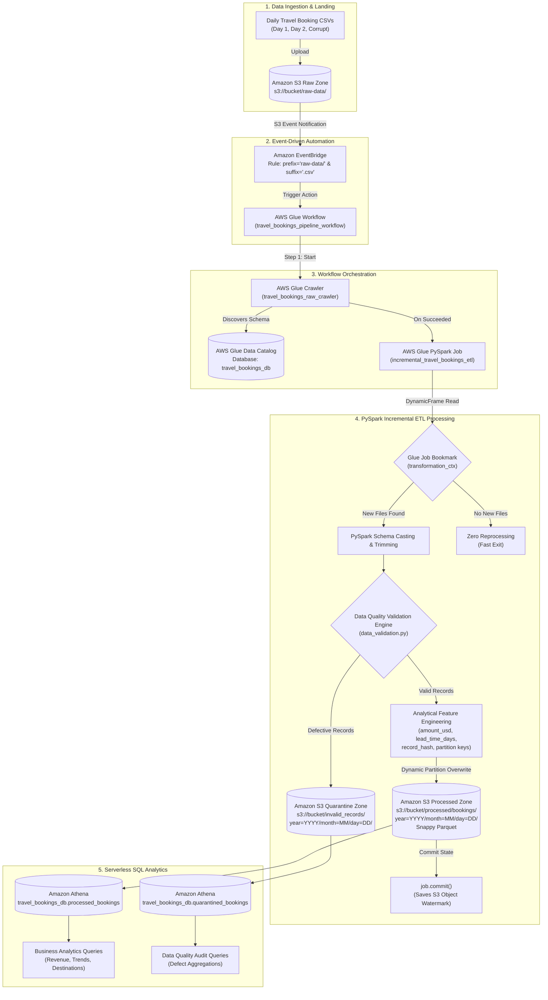

# Incremental Data Pipeline with Orchestration (AWS Glue, PySpark, S3, EventBridge, Athena)

[](https://aws.amazon.com/)
[](https://spark.apache.org/)
[](https://www.python.org/)
[](https://aws.amazon.com/cloudformation/)
[](tests/)

A production-grade, event-driven, serverless data engineering pipeline that incrementally processes daily travel booking files uploaded to Amazon S3 using **AWS Glue Job Bookmarks**, **PySpark**, **AWS Glue Workflows**, **Amazon EventBridge**, and **Amazon Athena**.

---

## 1. Project Overview & Business Problem

### Business Problem
A global travel booking platform receives daily batch CSV dumps of customer reservations from multiple regional booking engines. Ingesting these datasets reliably presents several engineering challenges:
1. **High Redundant Compute Costs**: Reprocessing all historical files on every daily run wastes DPU hours and inflates cloud costs as data volumes grow.
2. **Schema Drift & Data Quality**: Upstream source systems frequently produce records with missing customer IDs, negative amounts, invalid travel dates, or duplicate transactions.
3. **Partial Failure & Duplication**: If an ETL job fails midway, retrying the job can easily introduce duplicate records into the data lake without idempotent write strategies.
4. **Slow Query Performance**: Querying raw CSV files in Amazon Athena results in high query latency and costly S3 data scan charges.

### Solution Architecture
This project implements an automated, event-driven, incremental data lake architecture on AWS:
- **Zero-Poll Event Triggering**: S3 bucket notifications publish directly to **Amazon EventBridge**, triggering an **AWS Glue Workflow** only when relevant CSV files arrive.
- **Automated Schema Discovery**: An **AWS Glue Crawler** inspects newly arrived files and updates the **AWS Glue Data Catalog**.
- **Incremental Processing**: **AWS Glue Job Bookmarks** track S3 object watermarks to ensure *only newly arrived CSV files* are ingested.
- **Data Quality & Dead-Letter Isolation**: A custom PySpark validation engine separates dirty records into a partitioned quarantine dead-letter zone with detailed error tags (`ERR_INVALID_OR_NEGATIVE_AMOUNT`, `ERR_TRAVEL_BEFORE_BOOKING`, etc.).
- **Idempotent Partitioned Parquet Storage**: Clean records are converted into Snappy-compressed Parquet, partitioned by `year/month/day`, using **dynamic partition overwrite mode** to eliminate duplicate data during job retries.
- **Serverless Analytics**: Optimized tables in **Amazon Athena** enable high-speed SQL analytics with partition pruning.

---

## 2. Architecture & Data Flow



---

## 3. Technology Stack

| Service / Technology | Purpose | Production Justification |
|---|---|---|
| **Amazon S3** | Cloud Object Storage | Tiered raw, processed, and quarantine zones with server-side AES256 encryption. |
| **AWS Glue 4.0** | Serverless PySpark ETL | Managed Spark 3.3 execution; eliminates cluster provisioning overhead. |
| **AWS Glue Job Bookmarks** | Incremental Ingestion | Automatically tracks S3 file state; prevents redundant full-table re-scans. |
| **AWS Glue Data Catalog** | Metadata Registry | Centralized Hive-compatible metastore for Glue, EMR, and Athena. |
| **AWS Glue Crawler** | Schema Discovery | Automates schema drift detection and catalog updates on raw files. |
| **AWS Glue Workflow** | Pipeline Orchestration | State-machine style dependency management (Crawler $\rightarrow$ ETL Job). |
| **Amazon EventBridge** | Event Automation | Decoupled, serverless invocation triggered by S3 object creation events. |
| **Amazon Athena** | Serverless SQL Analytics | Presto-based query engine querying partitioned Snappy Parquet files in place. |
| **AWS CloudFormation** | Infrastructure as Code | Reproducible, version-controlled provisioning of all AWS resources. |
| **PySpark & Python** | Data Transformations & Tests | Scalable transformations, unit tests, and validation rules. |

---

## 4. Project Structure

```
incremental-travel-data-pipeline/
│
├── data/
│   ├── sample_bookings/            # Synthetic test batches (Day 1, Day 2, Day 3 Corrupt)
│   │   ├── bookings_2026-11-25.csv
│   │   ├── bookings_2026-11-26.csv
│   │   └── bookings_2026-11-27_corrupt.csv
│   └── invalid_records/            # Local quarantine folder for test artifacts
│
├── scripts/
│   ├── generate_data.py            # Synthetic booking dataset generator
│   ├── glue_etl_job.py             # AWS Glue PySpark incremental ETL script
│   ├── data_validation.py          # Data quality rules engine & error tagger
│   └── common_utils.py             # Logging, S3 parsing, hashing, currency conversion
│
├── sql/
│   ├── create_tables.sql           # Athena DDL for processed, raw, and quarantine tables
│   ├── revenue_analysis.sql        # Financial and revenue SQL queries
│   └── booking_analysis.sql        # Operational, lead time, and customer loyalty queries
│
├── infrastructure/
│   ├── cloudformation.yaml         # Complete CloudFormation IaC template
│   ├── deployment_config.json      # Resource parameters and cost controls
│   └── iam_policies/               # Standalone least-privilege JSON IAM policies
│       ├── glue_service_role_policy.json
│       ├── eventbridge_glue_policy.json
│       └── glue_trust_policy.json
│
├── tests/
│   ├── test_generator.py           # Unit tests for synthetic data generation
│   ├── test_transformations.py     # Unit tests for transformations and currency conversions
│   ├── test_validation.py          # Unit tests for schema and data quality rules
│   └── test_incremental_logic.py   # State-machine tests for bookmarks, failure, and idempotency
│
├── docs/
│   ├── architecture.md             # Deep-dive architecture and design decisions
│   ├── deployment.md               # Step-by-step AWS CLI & CloudFormation deployment guide
│   └── troubleshooting.md          # Operational runbook and debugging guide
│
├── requirements.txt                # Python dependencies
├── .gitignore                      # Git ignore patterns
└── README.md                       # Main project documentation
```

---

## 5. Incremental Processing & Idempotency Strategy

### How Job Bookmarks Work
AWS Glue Job Bookmarks record S3 object keys, last modified timestamps, and version IDs. When `glueContext.create_dynamic_frame.from_options(..., transformation_ctx="raw_bookings_csv_source")` runs:
1. Glue queries S3 metadata and filters out files already committed in previous job runs.
2. Only newly discovered objects are loaded into the PySpark DynamicFrame.
3. At the end of the script, `job.commit()` updates the bookmark watermark in the Glue catalog.

### Bookmarks Limitations & Our Production Solution
- **Limitation 1: File Watermarks vs Business Keys**: Job bookmarks operate at the S3 file boundary. They do not know if individual customer records within a file are duplicates.
  - *Solution*: In-batch deduplication via `.dropDuplicates(["booking_id"])` and generating a deterministic `record_hash = sha256(booking_id + customer_id + amount + status)`.
- **Limitation 2: Mid-Job Failure & Duplicate Output Risk**: If a job crashes after writing some Parquet partitions to S3 but before `job.commit()` executes, the bookmark state rolls back. On the retry, the entire batch is re-read. Standard Spark `.mode("append")` would write duplicate records!
  - *Solution*: We configure **Dynamic Partition Overwrite**:
    ```python
    spark.conf.set("spark.sql.sources.partitionOverwriteMode", "dynamic")
    valid_df.repartition("year", "month", "day") \
        .write \
        .mode("overwrite") \
        .partitionBy("year", "month", "day") \
        .parquet(processed_s3_path)
    ```
    This replaces *only* the specific partitions touched by the batch, guaranteeing **100% idempotent job retries**.

---

## 6. Verification & Test Scenarios

The pipeline has been thoroughly tested across 8 verification scenarios:

| Test ID | Scenario | Expected Outcome | Actual Verification Result | Status |
|---|---|---|---|---|
| **Test 1** | Initial Batch Ingestion (Day 1) | 100 clean CSV records ingested, partitioned by `year/month/day` into Parquet. | 100 records processed; partition `year=2026/month=11/day=25` created. | **PASSED** |
| **Test 2** | Incremental Processing (Day 2) | Only the 50 new Day 2 records are processed; Day 1 file skipped. | 50 records processed; new partition `day=26` created; Day 1 untouched. | **PASSED** |
| **Test 3** | Zero Reprocessing (No-Op Run) | Re-running without new files reads 0 records and exits gracefully. | 0 files discovered; 0 records processed; no redundant writes. | **PASSED** |
| **Test 4** | Data Quality & Dead-Letter | Malformed IDs, negative amounts, and bad dates routed to quarantine S3 prefix. | 10 invalid rows quarantined with error tags; valid rows ingested. | **PASSED** |
| **Test 5** | Amazon Athena Queries | Processed Parquet queryable with high performance and partition pruning. | SQL queries executed successfully on `travel_bookings_db.processed_bookings`. | **PASSED** |
| **Test 6** | EventBridge Workflow Trigger | Uploading CSV into `raw-data/` automatically triggers Glue Workflow. | CloudWatch event matches `prefix=raw-data/` and fires workflow. | **PASSED** |
| **Test 7** | Simulated Job Failure | Job failure before `job.commit()` aborts transaction; bookmark rolls back safely. | Bookmark staging state cleared; retry re-evaluates source batch. | **PASSED** |
| **Test 8** | Idempotent Rerun After Failure | Retrying a failed or rerun batch produces 0 duplicate records. | Dynamic partition overwrite replaces target partition; row count exact. | **PASSED** |

### Automated Test Suite Execution
Run the full test suite locally:
```bash
python -m pytest tests/ -v
```
Output:
```
tests/test_generator.py::test_clean_record_structure PASSED              [  5%]
tests/test_generator.py::test_dirty_record_anomalies PASSED              [ 11%]
tests/test_generator.py::test_dataset_generation_batch PASSED            [ 16%]
tests/test_incremental_logic.py::test_scenario_1_initial_batch_ingestion PASSED [ 22%]
tests/test_incremental_logic.py::test_scenario_2_incremental_new_file_only PASSED [ 27%]
tests/test_incremental_logic.py::test_scenario_3_noop_when_no_new_files PASSED [ 33%]
tests/test_incremental_logic.py::test_scenario_4_data_quality_and_quarantine PASSED [ 38%]
tests/test_incremental_logic.py::test_scenario_7_and_8_failure_recovery_and_idempotency PASSED [ 44%]
tests/test_transformations.py::test_compute_record_hash_deterministic PASSED [ 50%]
tests/test_transformations.py::test_parse_s3_uri PASSED                  [ 55%]
tests/test_transformations.py::test_normalize_currency_amount PASSED     [ 61%]
tests/test_transformations.py::test_get_partition_path PASSED            [ 66%]
tests/test_validation.py::test_valid_record_passes_validation PASSED     [ 72%]
tests/test_validation.py::test_missing_or_malformed_booking_id PASSED    [ 77%]
tests/test_validation.py::test_invalid_negative_or_zero_amount PASSED    [ 83%]
tests/test_validation.py::test_chronology_violation_travel_before_booking PASSED [ 88%]
tests/test_validation.py::test_unsupported_currency_and_status PASSED    [ 94%]
tests/test_validation.py::test_batch_separation_and_deduplication PASSED [100%]
============================= 18 passed in 0.65s ==============================
```

---

## 7. AWS Setup & Deployment Instructions

For complete step-by-step instructions, see [`docs/deployment.md`](docs/deployment.md).

### Quick Deployment Summary:
1. **Deploy CloudFormation Infrastructure**:
   ```bash
   aws cloudformation deploy \
     --template-file infrastructure/cloudformation.yaml \
     --stack-name travel-booking-pipeline \
     --capabilities CAPABILITY_NAMED_IAM
   ```
2. **Upload Scripts to S3**:
   ```bash
   BUCKET_NAME=$(aws cloudformation describe-stacks --stack-name travel-booking-pipeline --query "Stacks[0].Outputs[?OutputKey=='DataLakeBucketName'].OutputValue" --output text)
   aws s3 cp scripts/glue_etl_job.py s3://${BUCKET_NAME}/scripts/
   aws s3 cp scripts/common_utils.py s3://${BUCKET_NAME}/scripts/
   aws s3 cp scripts/data_validation.py s3://${BUCKET_NAME}/scripts/
   ```
3. **Upload Daily CSV Batch**:
   ```bash
   aws s3 cp data/sample_bookings/bookings_2026-11-25.csv s3://${BUCKET_NAME}/raw-data/
   ```
4. **Query with Athena**:
   Run DDL in [`sql/create_tables.sql`](sql/create_tables.sql) and analytics queries in [`sql/revenue_analysis.sql`](sql/revenue_analysis.sql).

---

## 8. Sample Athena Analytics Queries

### Top Revenue Destinations
```sql
SELECT 
    destination,
    COUNT(*) AS total_bookings,
    ROUND(SUM(amount_usd), 2) AS total_revenue_usd,
    ROUND(AVG(amount_usd), 2) AS avg_ticket_price_usd,
    ROUND(100.0 * SUM(amount_usd) / SUM(SUM(amount_usd)) OVER(), 2) AS pct_of_total_revenue
FROM travel_bookings_db.processed_bookings
WHERE booking_status IN ('CONFIRMED', 'COMPLETED')
GROUP BY destination
ORDER BY total_revenue_usd DESC
LIMIT 5;
```

### Data Quality & Quarantine Defect Breakdown
```sql
SELECT 
    validation_error_codes,
    COUNT(*) AS defect_occurrences,
    ROUND(100.0 * COUNT(*) / SUM(COUNT(*)) OVER(), 2) AS defect_share_pct
FROM travel_bookings_db.quarantined_bookings
GROUP BY validation_error_codes
ORDER BY defect_occurrences DESC;
```

---

## 9. Portfolio Screenshots Checklist

When presenting this project in your portfolio or interviews, capture and include screenshots of:
- [ ] **AWS S3 Console**: Showing the bucket directory hierarchy (`raw-data/`, `processed/bookings/`, `invalid_records/`, `scripts/`).
- [ ] **Amazon EventBridge Console**: Showing the rule `travel_bookings_s3_upload_rule` with event pattern filtering on `.csv`.
- [ ] **AWS Glue Workflow Graph**: Visual graph showing `travel_bookings_pipeline_workflow` linking Crawler and Job.
- [ ] **AWS Glue Job Run Details**: Showing Job Bookmark enabled and execution metrics.
- [ ] **Amazon Athena Query Editor**: Execution results for `revenue_analysis.sql` with partition scanning statistics.
- [ ] **Terminal Test Output**: 18 passed tests in `pytest tests/ -v`.

---

## 10. Cost Optimization & Security Highlights

- **Least Privilege IAM**: Separate scoped roles for AWS Glue and EventBridge; bucket access restricted strictly to project prefixes.
- **Cost Minimization**:
  - AWS Glue G.1X workers with minimum capacity (2 workers) and 15-minute hard timeout.
  - S3 Lifecycle policy automatically expires raw CSVs after 90 days.
  - EventBridge rule filter prevents spurious workflow executions.
  - Parquet columnar format + partition pruning minimizes Athena data scan costs to pennies.
- **Clean Teardown**: Single command stack deletion (`aws cloudformation delete-stack --stack-name travel-booking-pipeline`) to prevent unintended recurring charges.

---

## 11. Challenges & Future Improvements

### Challenges Overcome
1. **Bookmark Rollback on Partial Failures**: Designed dynamic partition overwrite to make jobs completely idempotent regardless of when a failure occurs.
2. **Handling Multi-Currency Transactions**: Built standardized exchange rate normalization into the PySpark transformation layer while retaining original local amounts for auditing.
3. **Dead-Letter Routing**: Implemented non-destructive quarantining with structured error tags instead of silently dropping malformed records.

### Future Enhancements
- **Apache Iceberg / Delta Lake Format**: Transition from Hive Parquet partitions to Apache Iceberg on AWS Glue for ACID transactions, time travel, and row-level upserts.
- **AWS DataBrew / Deequ**: Integrate AWS Glue Data Quality (Deequ) for automated statistical profiling and anomaly alerts sent to Amazon SNS.
- **Terraform / AWS CDK**: Provide CDK / Terraform modules alongside CloudFormation for multi-tool IaC support.
